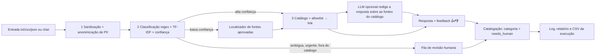

# Robô de triagem de pedidos de serviços públicos

Protótipo acadêmico da **FIAP — Global Solution 2026.2**, disciplina *AI for Robotic Process Automation*
(CitizenTech com RPA e IA). O enunciado está em [docs/enunciado-gs-2026-2-rpa-ia.pdf](docs/enunciado-gs-2026-2-rpa-ia.pdf).

## Integrantes

- Igor Paixão Sarak (RM 563726)
- Lucca Phelipe Masini (RM 564121)
- Bernardo Braga Perobeli (RM 562468)

## Pasta de entrega (`entrega-gs/`)

Os entregáveis do enunciado estão reunidos em [entrega-gs/](entrega-gs/):

- **README e índice:** [entrega-gs/README.md](entrega-gs/README.md) (este README traz a documentação completa);
- **Quadro de temas:** [entrega-gs/quadro-de-temas.md](entrega-gs/quadro-de-temas.md);
- **Evidências:** [entrega-gs/evidencias/evidence.ipynb](entrega-gs/evidencias/evidence.ipynb);
- **Dados, ética e ODS:** [entrega-gs/etica-dados-ods.md](entrega-gs/etica-dados-ods.md);
- **Código:** [run.py](run.py), [app.py](app.py) e [src/](src/), na raiz do repositório.

## Execução rápida

Requisitos: Python (verificado com 3.14) e internet (para instalar os pacotes e para o robô verificar os links). Comandos
para o PowerShell, na raiz do repositório:

```powershell
python -m venv .venv
.venv\Scripts\Activate.ps1
pip install -r requirements-dev.txt
Copy-Item .env.example .env        # depois preencha LLM_API_KEY no .env (opcional)
python scripts/train_model.py
python run.py --input data/samples
python -m streamlit run app.py
```

- **A chave vai só no `.env`** (`LLM_API_KEY`, copiado de `.env.example`; o `.env` não vai ao Git).
- **Sem chave, o robô funciona do mesmo jeito, em modo determinístico**: a resposta sai do texto-modelo do catálogo e a
  categoria da interação sai das regras. Para rodar de propósito sem o LLM: `python run.py --input data/samples --no-llm`.
- Rode `python scripts/train_model.py` **antes** do robô: sem o modelo, todo pedido vai à revisão humana.

## O problema e o público

Muita gente não sabe a qual órgão recorrer para tirar a CNH, atualizar o título de eleitor ou consultar um benefício
do INSS, e acaba perdida entre sites diferentes. Este robô atende o **cidadão** que descreve o que precisa em uma
frase: ele lê o pedido, descobre o assunto e responde com o **link oficial** do serviço, ou encaminha o pedido a
uma **fila de revisão humana** quando não tem segurança para responder.

**Recorte (piloto de São Paulo):** o **estado e a capital de São Paulo**, mais as **fontes federais**. O catálogo
(`data/catalog.json` mais `data/catalog.d/`) tem **127 fontes**, contadas por script sobre esses arquivos: **127
aprovadas**, que respondem ao cidadão (58 federais, 33 do Estado de São Paulo e 36 da cidade de São Paulo), e nenhuma
candidata. As 4 fontes da Prefeitura que estavam `candidate` por causa de um HTTP 403 foram aprovadas em 2026-11-12,
depois de responderem HTTP 200 ao identificador do robô.

O que o protótipo **não** é: não é um sistema de produção, não usa dado pessoal real, não faz deploy em nuvem e não é
um chatbot generalista.

## Como funciona



1. **Sanitização e anonimização:** limita o tamanho, neutraliza HTML e caracteres de controle e troca CPF, telefone,
   e-mail, nome, endereço, CEP, RG, data e documentos por marcadores antes de qualquer outro passo.
2. **Classificação:** atalho por regex quando o assunto é explícito; senão, TF-IDF com regressão logística. A
   confiança e a folga para a segunda melhor categoria decidem se o robô responde sozinho.
3. **Resposta:** só links do catálogo curado e da allowlist (`.gov.br` e órgãos oficiais), com o link verificado na rede.
   Pedido de urgência, fora do catálogo, ambíguo, de baixa confiança, inválido ou com link fora do ar vai à revisão
   humana. Antes de desistir de um pedido de baixa confiança ou fora do catálogo, o **localizador** procura entre as
   fontes aprovadas a que atende o texto.
4. **Catalogação:** cada interação recebe uma **categoria** (saúde, impostos, trânsito, documentos…) de uma lista
   fechada em `data/interaction_topics.json`. Quem escolhe é o **LLM**; sem ele, ou quando ele falha, escolhem as regras
   (a área da fonte do catálogo ou o mapa do classificador), e urgência vira `safety` por regra, sem chamar o LLM. A
   interação ganha também a tag **`needs_human`**, verdadeira quando o pedido **não** foi respondido (foi à revisão ou
   foi rejeitado). Cada execução em lote grava as interações em `exports/interactions-run-<id>.csv` (dentro da pasta
   `--output`), além do relatório em `reports/`.

### A interface

`python -m streamlit run app.py` abre duas abas:

- **Cidadão:** um **chat com memória**. O robô considera as últimas mensagens da conversa (`chat.history_turns` em
  `config/settings.json`, padrão 6) para achar a fonte e redigir a resposta; assim, "me passe o link correto para
  parcelamento" entende que o assunto é o IPTU da mensagem anterior. Cada resposta traz os botões **👍/👎**, e **Nova
  conversa** limpa o histórico, a memória e as avaliações da tela. A classificação, a urgência e a revisão humana
  continuam decididas só pela mensagem atual.
- **Revisão:** a fila de pedidos pendentes, com o texto **anonimizado**, a categoria sugerida e a confiança. A pessoa
  escolhe a **categoria correta**, escreve uma nota e marca como resolvido; o botão de **exportação** grava um CSV de
  pedidos rotulados (só com texto anonimizado, que precisa de revisão humana antes de virar dado de treino).

O histórico da conversa vive só na sessão do Streamlit e some ao recarregar a página; o banco guarda apenas a mensagem
atual, anonimizada. **Com o LLM ligado**, as mensagens anteriores, já anonimizadas, também saem rumo ao provedor a cada
turno, e o risco residual cresce com o tamanho da conversa (limites em *Proteção de dados, ética e ODS*). Sem o LLM,
nada da conversa sai do computador.

## Como instalar e rodar

Os comandos do bloco **Execução rápida** são o caminho completo. O que cada um faz:

| Passo | O que faz |
|---|---|
| `pip install -r requirements-dev.txt` | instala o robô (`requirements.txt`) e as ferramentas de teste, lint e notebook |
| `python scripts/train_model.py` | treina o classificador com `split=train` e grava `output/models/classifier.joblib` |
| `python run.py --input data/samples` | processa a pasta de pedidos; grava log, banco SQLite, relatório e CSV das interações em `output/` |
| `python -m streamlit run app.py` | abre a interface local (abas **Cidadão** e **Revisão**) |

Opções do robô: `--input <pasta>` (padrão `data/samples`), `--output <pasta>` (padrão `output`), `--db <arquivo>`,
`--watch` com `--interval <segundos>` (reexecuta até Ctrl+C) e `--llm` / `--no-llm`. Código de saída: `0` ok, `1`
falha de infraestrutura (banco ou disco), `2` pasta de entrada inválida. Rodar a mesma pasta de novo não repete os
pedidos já processados.

**Testes e lint:**

```powershell
python -m pytest -q
python -m ruff check run.py src tests
```

## Notebook de evidências

[`entrega-gs/evidencias/evidence.ipynb`](entrega-gs/evidencias/evidence.ipynb) **já vem executado, de ponta a ponta, com o LLM real**: as saídas salvas são as evidências.
Ele mostra o robô rodando em lote e por perguntas (com a categoria e a tag `needs_human` de cada interação), as métricas
de classificação e do localizador, e cada falha tratada (pasta inexistente, JSON inválido, link fora do ar, resposta vazia
do LLM, LLM fora do ar, modelo ausente).

Para **reexecutar**, o notebook precisa da chave no `.env` da **raiz** do projeto e de rede. Grave num arquivo novo, para
não sobrescrever o entregue:

```powershell
jupyter nbconvert --to notebook --execute entrega-gs/evidencias/evidence.ipynb --output evidence-reexecutado.ipynb
```

O notebook treina o modelo em memória e remove o que cria; apague `evidence-reexecutado.ipynb` depois. Como a saída do
LLM varia entre execuções, os totais da seção por perguntas podem mudar.

## Como configurar as chaves

A configuração entregue **liga o LLM** (`llm.enabled: true`); sem `LLM_API_KEY`, o robô cai no **modo determinístico**
(texto-modelo), sem LLM e sem nenhuma chave. A configuração tem duas fontes:

- **`.env`** (fora do Git): guarda **só a chave** do LLM, `LLM_API_KEY`. Nenhuma outra variável de ambiente altera o robô.
- **`config/settings.json`** (versionado): todo o resto. Arquivo ausente ou JSON inválido impede o robô de subir (código de
  saída `1` no `run.py`; mensagem na tela no `app.py`). Campo ausente ou inválido volta ao padrão e é avisado no log.

Para usar o LLM:

1. Copie `.env.example` para `.env` e preencha `LLM_API_KEY` com a chave de um provedor de API compatível com
   `/chat/completions` (os modelos de `config/settings.json` são do OpenRouter).
2. O `llm.enabled` já vem `true`; para desligar, troque para `false`. Também dá para escolher por execução:
   `python run.py --llm` ou `--no-llm`.

| Chave de `config/settings.json` | Para que serve |
|---|---|
| `log_level` | nível do log (padrão `INFO`) |
| `llm.enabled` | liga (`true`) ou desliga o LLM; entregue ligado |
| `llm.base_url`, `llm.model` | provedor (formato `/chat/completions`) e modelo principal |
| `llm.fallback_models` | lista de modelos alternativos, tentados na ordem se o principal falhar; pode ser vazia |
| `llm.agent_id` | agente em `data/agents/<id>/` (padrão `triage-assistant`) |
| `triage.confidence_min`, `triage.ambiguity_margin` | limiares da revisão humana (padrão `0.60` e `0.15`), em [0, 1] |
| `finder.min_score`, `finder.margin` | limiares do localizador de fontes (padrão `0.25` e `0.15`), em [0, 1] |
| `link_check.user_agent` | identificação do verificador de links (nome do projeto; não imita navegador) |
| `chat.history_turns` | quantas mensagens anteriores o chat considera (padrão 6) |

**Base enriquecida.** Além de `data/catalog.json`, o robô lê todo `data/catalog.d/*.json`: páginas oficiais por tarefa,
cada uma com um trecho oficial (`content`) que ajuda a achar a fonte e que o LLM usa para responder com mais detalhe.
O registro só responde se estiver `approved`, com domínio na allowlist e link no ar; `python scripts/verify_catalog.py`
audita o conjunto. Formato e passo a passo: [docs/guia-da-base-enriquecida.md](docs/guia-da-base-enriquecida.md). A base
importada da planilha [docs/catalogo_servicos_publicos_expandido_rpa.xlsx](docs/catalogo_servicos_publicos_expandido_rpa.xlsx)
vira `data/catalog.d/sp_expanded.json` por `python scripts/import_catalog_xlsx.py`. A lista de fontes de São Paulo e o
que ficou pendente: [docs/fontes-publicas-sp-para-aprovacao.md](docs/fontes-publicas-sp-para-aprovacao.md).

## Agente LLM

O LLM é **opcional**: o robô funciona por inteiro sem ele. A configuração entregue o liga, e o comportamento dele não
está no código: o **agente** é definido por arquivos versionados em `data/agents/`.

O agente executa **duas tarefas**, ambas em `workflow.md`:

| Tarefa | O que o LLM faz | Se o LLM faltar ou falhar |
|---|---|---|
| `answer` | **redige a resposta** ao cidadão a partir da pergunta anonimizada e das **fontes aprovadas** recuperadas do catálogo (o catálogo é o RAG do agente) | responde o texto-modelo do catálogo (ou "não tenho a informação") |
| `categorize` | **escolhe a categoria da interação**, só entre os ids de `data/interaction_topics.json` | escolhem as regras: área da fonte ou mapa do classificador |

O LLM nunca decide se o pedido é respondido nem escolhe URL: recebe só texto anonimizado e fontes já aprovadas, e a
**saída passa por uma guarda**. Na resposta, todo link e todo telefone têm de ser de uma das fontes enviadas, e ao menos um
deles tem de aparecer; saída vazia, longa demais ou com link ou telefone alheio é descartada, e responde o texto-modelo
com o motivo no log e no relatório. Na categoria, só vale o id exato da lista. Urgência, pedido ambíguo e modelo ausente
nunca chamam o LLM.

**Modelos gratuitos.** A lista `llm.fallback_models` entregue inclui modelos gratuitos do OpenRouter (os terminados em
`:free`). Um modelo pode devolver **conteúdo vazio**: o robô registra a falha, **passa ao modelo seguinte** da lista e,
esgotados todos, cai no **template**. O nome de um modelo gratuito muda com o tempo; confira a lista do provedor.

| Arquivo | Papel |
|---|---|
| `data/agents/global_rules.md` | regras que valem para todo agente |
| `data/agents/<id>/identity.md` | persona e tom de voz |
| `data/agents/<id>/rules.md` | limites rígidos |
| `data/agents/<id>/workflow.md` | uma seção `## Tarefa: <nome>` por tarefa (`answer` e `categorize`) |
| `data/agents/<id>/config.json` | temperatura, `max_tokens`, timeout e política de tentativas |

**`.env` × versionado:** o `.env` guarda só a chave (`LLM_API_KEY`); provedor, modelos, `llm.agent_id` e o interruptor
`llm.enabled` ficam em `config/settings.json`; o comportamento do agente fica nos arquivos acima. Provedor e modelo se
trocam só em `config/settings.json`: Groq e OpenRouter, por exemplo, falam o mesmo formato de chat. A seção `llm` entregue:

```json
"llm": {
  "enabled": true,
  "base_url": "https://openrouter.ai/api/v1",
  "model": "deepseek/deepseek-v4-flash",
  "fallback_models": ["deepseek/deepseek-v4-flash-0731", "deepseek/deepseek-v3.2", "minimax/minimax-m3:free", "openrouter/free"],
  "agent_id": "triage-assistant"
}
```

Agente ausente ou inválido também desliga o LLM (com log de erro) e o texto-modelo responde. Para validar os arquivos do
agente:

```powershell
python scripts/validate_agent.py
```

## Estrutura de pastas

```text
run.py                   ponto de entrada do robô
app.py                   interface Streamlit
.env.example             modelo do .env (só LLM_API_KEY)
config/settings.json     configuração versionada
scripts/                 train_model.py, validate_agent.py, verify_catalog.py, import_catalog_xlsx.py
src/triage/
  ingestion/             leitura de txt/csv/json e sanitização
  privacy/               anonimização de PII (CPF, contato, nome, endereço, documentos)
  classification/        regex, TF-IDF, confiança e decisão de revisão
  automation/            catálogo, allowlist, verificação de links, localizador, resposta e LLM opcional
    topics.py            categoria da interação (LLM, com regras como caminho seguro)
  agent/                 leitura do agente LLM de data/agents/ e linter
  storage/               SQLite: idempotência, fila de revisão, feedback e catalogação
  pipeline/              orquestração, retry, relatório e agendamento
    export.py            CSV das interações de cada execução
  interface/             serviço e telas do Streamlit
  evaluation/            métricas de validação (usadas pelo notebook)
data/
  catalog.json           catálogo curado de fontes públicas
  catalog.d/             base enriquecida (páginas oficiais por tarefa)
  allowed_domains.json   allowlist de domínios
  interaction_topics.json  vocabulário fechado das categorias de interação
  agents/                agente LLM versionado (persona, regras, tarefas, parâmetros)
  labeled/               conjuntos rotulados (classificador e localizador)
  samples/               pedidos de exemplo, inclusive arquivos defeituosos
entrega-gs/              entregáveis do enunciado: README, quadro de temas, ética e ODS e evidencias/evidence.ipynb (já executado)
docs/                    enunciado, guia da base enriquecida, fontes de SP e planilha do catálogo
  especificacoes/        documentação técnica do projeto (especificações e decisões de arquitetura)
tests/                   testes automatizados
output/                  gerado na execução: logs, banco, modelo, reports/ e exports/ (fora do Git)
```

## Quadro de temas

Resumo; o quadro completo, com a justificativa da combinação, está em [entrega-gs/quadro-de-temas.md](entrega-gs/quadro-de-temas.md).

| Tema | Onde entra no fluxo | O que resolve |
|---|---|---|
| Automação / RPA | todo o pipeline: leitura da pasta, retry, idempotência, relatório e CSV | processa o lote sem intervenção; uma falha não derruba as demais |
| NLP | etapa 2: normalização e TF-IDF | entende o assunto de frases livres e mede a confiança |
| Regras / regex | etapas 1 e 2: sanitização, atalhos por palavra-chave e urgência | barra entrada ruim, resolve o óbvio e aciona a revisão em emergências |
| Anonimização de PII | etapa 1: antes de classificar, gravar ou logar | nenhum dado pessoal chega ao log, ao banco ou a uma API |

## Resultados

Todos os números abaixo são as **saídas salvas** de [entrega-gs/evidencias/evidence.ipynb](entrega-gs/evidencias/evidence.ipynb), executado com o
LLM real em 2026-11-12. Os dados são sintéticos; os números descrevem estas amostras, não pedidos reais.

**Classificação** (sem LLM; `split=test`, **54 pedidos**, 6 por categoria, com o modelo treinado em 364 pedidos de
`split=train` e os limiares `CONFIDENCE_MIN=0,60` e `AMBIGUITY_MARGIN=0,15`):

| Métrica | Resultado |
|---|---|
| Acurácia geral | 88,9% (6 erros em 54 pedidos; um pedido a mais ou a menos muda 1,9%) |
| Pedidos enviados à revisão humana | 33,3% |
| Cobertura automática (respondidos sem revisão) | 66,7% (36 pedidos) |
| Acurácia entre os respondidos sozinhos | 100,0% |
| Motivos de revisão no teste | `low_confidence` 10, `out_of_catalog` 7, `urgent` 1 |
| Confiança média dos acertos / dos erros | 0,77 / 0,31 |

Os 6 erros de classificação foram todos encaminhados à revisão humana; nenhum virou resposta errada.

**Calibração dos limiares**, por validação cruzada de 5 partes **só no treino** (364 pedidos, acurácia fora da amostra de
92,9%), nunca no conjunto de teste:

| `CONFIDENCE_MIN` | 0,40 | 0,50 | 0,55 | **0,60** | 0,70 | 0,80 |
|---|---|---|---|---|---|---|
| Cobertura automática | 76,9% | 72,0% | 71,2% | **69,2%** | 65,9% | 63,7% |
| Acurácia entre os respondidos | 96,8% | 97,3% | 97,7% | **98,0%** | 98,3% | 98,7% |

Nenhum valor abaixo de 0,60 amplia a cobertura sem piorar a acurácia entre os respondidos, então `0,60` foi **mantido**. A
`AMBIGUITY_MARGIN` não muda o resultado entre 0,05 e 0,25.

**Localizador de fontes** (sem LLM, `ServiceFinder`), medido em 96 pedidos sintéticos (48 de treino, para ajustar os
limiares, e 48 de teste, só para reportar) sobre as **127 fontes aprovadas** do catálogo atual:

| | Cobertura | Acerto entre os que devolveram fonte | Falso positivo (pedido sem fonte que recebeu uma) |
|---|---|---|---|
| Teste | 27,1% (13 com fonte) | 76,9% (10 de 13) | 5,6% (1 de 18) |
| Treino | 22,9% (11 com fonte) | 81,8% (9 de 11) | 5,6% (1 de 18) |

Os padrões `FINDER_MIN_SCORE=0,25` e `FINDER_MARGIN=0,15` preferem dizer "não sei" a apontar a fonte errada, e isso
custa cobertura. No teste, 3 fontes devolvidas não eram a esperada (uma delas para um pedido de passaporte, que não tem
fonte aprovada).

**Execução com o LLM real:**

- **Lote** (`data/samples`, 15 pedidos): 7 respondidos, 1 encaminhado à revisão (`out_of_catalog`) e 7 rejeitados na
  ingestão (arquivos defeituosos); dos 7 respondidos, 7 com link no ar e nenhum fora do ar. A segunda execução da mesma
  pasta ignorou os 15 como já processados.
- **Teste por perguntas** (18 perguntas, pela mesma rota do chat): 15 respondidas e 3 encaminhadas à revisão
  (emergência, fora de escopo e tentativa de injeção); 17 categorias da interação escolhidas pelo LLM; **0 de 16 URLs** das
  respostas fora do catálogo; **0 de 33 mensagens** enviadas ao LLM com dado pessoal bruto.
- **Sem LLM** (as mesmas 18 perguntas): 9 respondidas e 9 encaminhadas à revisão, contra 15 e 3 com o LLM.

Matriz de confusão, métricas por classe, análise dos erros, casos de falha tratados e limites estão no
[notebook](entrega-gs/evidencias/evidence.ipynb).

## Proteção de dados, ética e ODS

O protótipo usa só dados sintéticos e anonimiza CPF, telefone, e-mail, nome, endereço, CEP, RG, data e números de
documento antes de qualquer log, gravação ou chamada a API, em linha com a LGPD. O dado pessoal só vai anonimizado ao
provedor do LLM, e a saída do LLM passa por uma guarda. Há risco residual (nome fora de contexto, endereço sem
logradouro), então nenhum dado pessoal real deve ser digitado. O robô prefere a revisão humana a arriscar uma resposta
errada. ODS confirmados pelo grupo: **16** e **10**. Texto completo: [entrega-gs/etica-dados-ods.md](entrega-gs/etica-dados-ods.md).
