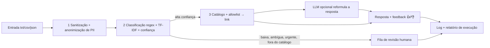

# Robô de triagem de pedidos de serviços públicos

Protótipo acadêmico da **FIAP — Global Solution 2026.2**, disciplina *AI for Robotic Process Automation*
(CitizenTech com RPA e IA).

## Integrantes

- `<preencher>`
- `<preencher>`
- `<preencher>`

## O problema e o público

Muita gente não sabe a qual órgão recorrer para tirar a CNH, atualizar o título de eleitor ou consultar um benefício
do INSS, e acaba perdida entre sites diferentes. Este robô atende o **cidadão** que descreve o que precisa em uma
frase: ele lê o pedido, descobre o assunto e responde com o **link oficial** do serviço, ou encaminha o pedido a
uma **fila de revisão humana** quando não tem segurança para responder. O recorte são 8 serviços públicos federais
(CNH, CPF, identidade, certidão de nascimento, título de eleitor, Cadastro Único, INSS e IPTU).

O que o protótipo **não** é: não é um sistema de produção, não usa dado pessoal real, não faz deploy em nuvem e não é
um chatbot generalista.

## Como funciona



1. **Sanitização e anonimização:** limita o tamanho, neutraliza HTML e caracteres de controle e troca CPF, telefone,
   e-mail, nome, endereço, CEP, RG, data e documentos por marcadores antes de qualquer outro passo.
2. **Classificação:** atalho por regex quando o assunto é explícito; senão, TF-IDF com regressão logística. A
   confiança e a folga para a segunda melhor categoria decidem se o robô responde sozinho.
3. **Resposta:** só links do catálogo curado e da allowlist (`.gov.br`), com o link verificado na rede. Pedido de
   urgência, fora do catálogo, ambíguo, de baixa confiança, inválido ou com link fora do ar vai à revisão humana.

## Como instalar e rodar

Requisitos: Python (verificado com 3.14) e acesso à internet para instalar os pacotes e para o robô verificar os
links. Os comandos abaixo são para o PowerShell, na raiz do repositório.

```powershell
python -m venv .venv
.venv\Scripts\Activate.ps1
pip install -r requirements-dev.txt
python scripts/train_model.py
python run.py --input data/samples
streamlit run app.py
```

| Passo | O que faz |
|---|---|
| `pip install -r requirements-dev.txt` | instala o robô (`requirements.txt`) e as ferramentas de teste, lint e notebook |
| `python scripts/train_model.py` | treina o classificador com `split=train` e grava `output/models/classifier.joblib`. **Rode antes do robô:** sem o modelo, todo pedido vai à revisão humana |
| `python run.py --input data/samples` | processa a pasta de pedidos; grava log, banco SQLite e relatório em `output/` |
| `streamlit run app.py` | abre a interface local: aba **Cidadão** (pedido, resposta e 👍/👎) e aba **Revisão** (fila pendente) |

Opções do robô: `--input <pasta>` (padrão `data/samples`), `--output <pasta>` (padrão `output`), `--db <arquivo>`,
`--watch` com `--interval <segundos>` (reexecuta até Ctrl+C) e `--llm` / `--no-llm`. Código de saída: `0` ok, `1`
falha de infraestrutura (banco ou disco), `2` pasta de entrada inválida. Rodar a mesma pasta de novo não repete os
pedidos já processados.

**Notebook de evidências:** `notebooks/evidence.ipynb` já traz as saídas salvas. Para reexecutar:

```powershell
jupyter nbconvert --to notebook --execute notebooks/evidence.ipynb --output evidence-reexecutado.ipynb
```

(o notebook treina o modelo em memória e remove o que cria em `output/`; apague `evidence-reexecutado.ipynb` depois).

**Testes e lint:**

```powershell
python -m pytest -q
python -m ruff check run.py src tests
```

## Como configurar as chaves

O robô funciona **sem nenhuma chave**: o LLM é opcional e vem **desligado**. Para ligá-lo:

1. Copie `.env.example` para `.env` (o `.env` está no `.gitignore` e nunca vai ao repositório).
2. Preencha `LLM_ENABLED=true`, `LLM_BASE_URL`, `LLM_MODEL` e `LLM_API_KEY` com um provedor de API compatível com
   `/chat/completions` e de camada gratuita.

| Variável | Para que serve |
|---|---|
| `LLM_ENABLED` | liga (`true`) ou desliga o LLM; padrão desligado |
| `LLM_BASE_URL`, `LLM_MODEL`, `LLM_API_KEY` | provedor, modelo e chave do LLM (só no `.env`) |
| `LOG_LEVEL` | nível do log (padrão `INFO`) |
| `CONFIDENCE_MIN`, `AMBIGUITY_MARGIN` | limiares da revisão humana (padrão `0.60` e `0.15`), opcionais |

O LLM só **reformula** a resposta que o robô já decidiu e recebe apenas o texto-modelo da resposta, nunca o pedido do
cidadão. Se ele falhar, vier vazio ou trouxer um link fora do esperado, vale o texto-modelo e o motivo vai para o log.
Nenhum dado pessoal real deve ser enviado a nenhuma API.

## Estrutura de pastas

```text
run.py                   ponto de entrada do robô
app.py                   interface Streamlit
scripts/train_model.py   treina e grava o classificador
src/triage/
  ingestion/             leitura de txt/csv/json e sanitização
  privacy/               anonimização de PII (CPF, contato, nome, endereço, documentos)
  classification/        regex, TF-IDF, confiança e decisão de revisão
  automation/            catálogo, allowlist, verificação de links, resposta e LLM opcional
  storage/               SQLite: idempotência, fila de revisão e feedback
  pipeline/              orquestração, retry, relatório e agendamento
  interface/             serviço e telas do Streamlit
  evaluation/            métricas de validação (usadas pelo notebook)
data/                    catálogo, allowlist, léxico de urgência, amostras e conjunto rotulado
notebooks/               evidence.ipynb (evidências de validação)
docs/                    quadro de temas
tests/                   testes automatizados
specs/                   especificações do projeto
```

## Quadro de temas

Resumo; o quadro completo, com a justificativa da combinação, está em [docs/quadro-de-temas.md](docs/quadro-de-temas.md).

| Tema | Onde entra no fluxo | O que resolve |
|---|---|---|
| Automação / RPA | todo o pipeline: leitura da pasta, retry, idempotência, relatório | processa o lote sem intervenção; uma falha não derruba as demais |
| NLP | etapa 2: normalização e TF-IDF | entende o assunto de frases livres e mede a confiança |
| Regras / regex | etapas 1 e 2: sanitização, atalhos por palavra-chave e urgência | barra entrada ruim, resolve o óbvio e aciona a revisão em emergências |
| Anonimização de PII | etapa 1: antes de classificar, gravar ou logar | nenhum dado pessoal chega ao log, ao banco ou a uma API |

## Resultados

Medidos no mesmo conjunto de teste (`split=test`, **54 pedidos sintéticos**, 6 por categoria, sem nenhuma linha alterada),
sem LLM. O que mudou foi o treino do modelo: **antes**, 126 pedidos (14 por categoria); **depois**, 364 pedidos (pelo
menos 40 por categoria, 44 em `other`):

| Métrica | Antes (126 de treino) | Depois (364 de treino) |
|---|---|---|
| Acurácia geral | 81,5% (44 de 54) | 88,9% (48 de 54) |
| Pedidos enviados à revisão humana | 42,6% (23 de 54) | 33,3% (18 de 54) |
| Cobertura automática | 57,4% (31 de 54) | 66,7% (36 de 54) |
| Acurácia entre os respondidos sozinhos | 100% (31 de 31) | 100% (36 de 36) |
| Confiança média dos acertos / dos erros | 0,73 / 0,26 | 0,77 / 0,31 |

Os 6 erros de classificação restantes foram todos encaminhados à revisão humana; nenhum virou resposta errada. Os
limiares `CONFIDENCE_MIN=0,60` e `AMBIGUITY_MARGIN=0,15` foram reavaliados por validação cruzada de 5 partes **só no
treino** (364 pedidos) e **mantidos**: baixar a confiança mínima aumenta a cobertura (69,2% em 0,60; 71,2% em 0,55;
76,9% em 0,40), mas a acurácia entre os respondidos cai (98,0%; 97,7%; 96,8%), e a folga de ambiguidade não muda o
resultado. A amostra é pequena e sintética (cada pedido de teste vale cerca de 1,9 ponto percentual): isto descreve
esta amostra sintética, não pedidos reais. Matriz de confusão, métricas por classe, tabela de limiares, análise dos
erros, casos de falha tratados (arquivo ausente, JSON inválido, link fora do ar, resposta vazia do LLM, modelo ausente)
e limites estão em [notebooks/evidence.ipynb](notebooks/evidence.ipynb).

## Proteção de dados, ética e ODS

O protótipo usa só dados sintéticos e anonimiza CPF, telefone, e-mail, nome de pessoa, endereço (logradouro com
número e complementos), CEP, RG, data completa e números de documento (título de eleitor, CNH, NIS, PIS, cartão SUS,
CNPJ, passaporte, matrícula) antes de qualquer log, gravação ou chamada a API, em linha com a LGPD (minimização e
finalidade). A anonimização usa regex, contexto e uma lista de prenomes, sem modelo de NER, e na dúvida mascara.
Limites declarados (risco residual): nome fora de contexto e fora da lista pode passar; endereço sem logradouro
passa; cidade, estado e bairro não são mascarados. Do ponto de vista ético, o robô só responde com links de domínios oficiais da allowlist, prefere pedir
**revisão humana** a arriscar uma resposta errada (urgência, dúvida e fora do catálogo vão para uma pessoa) e deixa
claro que é um protótipo; o LLM, se ligado, apenas reformula o que já foi decidido. Como candidatos a ODS, o
**ODS 16** (instituições eficazes e acesso à informação) e o **ODS 10** (redução das desigualdades, ao facilitar o
acesso a serviços para quem não sabe a qual órgão recorrer) — *a confirmar com o grupo*.
