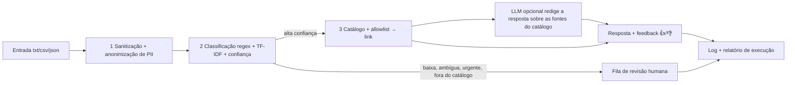

# Robô de triagem de pedidos de serviços públicos

Protótipo acadêmico da **FIAP — Global Solution 2026.2**, disciplina *AI for Robotic Process Automation*
(CitizenTech com RPA e IA).

## Integrantes

- Igor Paixão Sarak (RM 563726)
- Lucca Phelipe Masini (RM 564121)
- Bernardo Braga Perobeli (RM 562468)

## O problema e o público

Muita gente não sabe a qual órgão recorrer para tirar a CNH, atualizar o título de eleitor ou consultar um benefício
do INSS, e acaba perdida entre sites diferentes. Este robô atende o **cidadão** que descreve o que precisa em uma
frase: ele lê o pedido, descobre o assunto e responde com o **link oficial** do serviço, ou encaminha o pedido a
uma **fila de revisão humana** quando não tem segurança para responder. O recorte são 8 serviços públicos federais
(CNH, CPF, identidade, certidão de nascimento, título de eleitor, Cadastro Único, INSS e IPTU).

O que o protótipo **não** é: não é um sistema de produção, não usa dado pessoal real, não faz deploy em nuvem e não é
um chatbot generalista.

## Como funciona



1. **Sanitização e anonimização:** limita o tamanho, neutraliza HTML e caracteres de controle e troca CPF, telefone,
   e-mail, nome, endereço, CEP, RG, data e documentos por marcadores antes de qualquer outro passo.
2. **Classificação:** atalho por regex quando o assunto é explícito; senão, TF-IDF com regressão logística. A
   confiança e a folga para a segunda melhor categoria decidem se o robô responde sozinho.
3. **Resposta:** só links do catálogo curado e da allowlist (`.gov.br`), com o link verificado na rede. Pedido de
   urgência, fora do catálogo, ambíguo, de baixa confiança, inválido ou com link fora do ar vai à revisão humana.

## Conversa com memória

No chat da aba **Cidadão**, a conversa tem memória: para achar a fonte e redigir a resposta, o robô considera também as
últimas mensagens do cidadão naquela conversa (`chat.history_turns` em `config/settings.json`, padrão 6). Assim,
"me passe o link correto para parcelamento" entende que o assunto é o IPTU da mensagem anterior. A classificação, a
urgência e a revisão humana continuam decididas só pela mensagem atual. Repetir uma pergunta no chat gera uma nova
resposta, e não o aviso de pedido já registrado.

O botão **Nova conversa** limpa o histórico, a memória e as avaliações da tela e começa outra conversa. O histórico vive
só na sessão do Streamlit e some ao recarregar a página; o banco guarda apenas a mensagem atual, anonimizada.

**O que a mais vai ao provedor:** com o LLM ligado, as mensagens anteriores da conversa, já anonimizadas, saem rumo ao
provedor a cada turno, além da mensagem atual. A anonimização reduz o risco, mas não o elimina (limites em *Proteção de
dados, ética e ODS*), e o risco residual cresce com o tamanho da conversa. Sem o LLM, nada da conversa sai do computador.

## Como instalar e rodar

Requisitos: Python (verificado com 3.14) e acesso à internet para instalar os pacotes e para o robô verificar os
links. Os comandos abaixo são para o PowerShell, na raiz do repositório.

```powershell
python -m venv .venv
.venv\Scripts\Activate.ps1
pip install -r requirements-dev.txt
python scripts/train_model.py
python run.py --input data/samples
streamlit run app.py
```

| Passo | O que faz |
|---|---|
| `pip install -r requirements-dev.txt` | instala o robô (`requirements.txt`) e as ferramentas de teste, lint e notebook |
| `python scripts/train_model.py` | treina o classificador com `split=train` e grava `output/models/classifier.joblib`. **Rode antes do robô:** sem o modelo, todo pedido vai à revisão humana |
| `python run.py --input data/samples` | processa a pasta de pedidos; grava log, banco SQLite e relatório em `output/` |
| `streamlit run app.py` | abre a interface local: aba **Cidadão** (pedido, resposta e 👍/👎) e aba **Revisão** (fila pendente) |

Opções do robô: `--input <pasta>` (padrão `data/samples`), `--output <pasta>` (padrão `output`), `--db <arquivo>`,
`--watch` com `--interval <segundos>` (reexecuta até Ctrl+C) e `--llm` / `--no-llm`. Código de saída: `0` ok, `1`
falha de infraestrutura (banco ou disco), `2` pasta de entrada inválida. Rodar a mesma pasta de novo não repete os
pedidos já processados.

**Notebook de evidências:** `notebooks/evidence.ipynb` já traz as saídas salvas. Para reexecutar:

```powershell
jupyter nbconvert --to notebook --execute notebooks/evidence.ipynb --output evidence-reexecutado.ipynb
```

(o notebook treina o modelo em memória e remove o que cria em `output/`; apague `evidence-reexecutado.ipynb` depois).

**Testes e lint:**

```powershell
python -m pytest -q
python -m ruff check run.py src tests
```

## Como configurar as chaves

A configuração entregue **liga o LLM** (`llm.enabled: true`); sem `LLM_API_KEY`, o robô cai no **modo determinístico** (texto-modelo), sem LLM e sem nenhuma chave. A configuração tem duas fontes:

- **`.env`** (fora do Git): guarda **só a chave** do LLM, `LLM_API_KEY`. Nenhuma outra variável de ambiente altera o robô.
- **`config/settings.json`** (versionado): todo o resto. Arquivo ausente ou JSON inválido impede o robô de subir (código de
  saída `1` no `run.py`; mensagem na tela no `app.py`). Campo ausente ou inválido volta ao padrão e é avisado no log.

Para usar o LLM:

1. Copie `.env.example` para `.env` (o `.env` está no `.gitignore` e nunca vai ao repositório) e preencha `LLM_API_KEY`
   com a chave de um provedor de API compatível com `/chat/completions` (os modelos de `config/settings.json` são do OpenRouter).
2. O `llm.enabled` já vem `true` em `config/settings.json`; para desligar, troque para `false`. Também dá para ligar só numa execução: `python run.py --llm`.

| Chave de `config/settings.json` | Para que serve |
|---|---|
| `log_level` | nível do log (padrão `INFO`) |
| `llm.enabled` | liga (`true`) ou desliga o LLM; entregue ligado |
| `llm.base_url`, `llm.model` | provedor (formato `/chat/completions`) e modelo principal |
| `llm.fallback_models` | lista de modelos alternativos, tentados na ordem se o principal falhar; pode ser vazia |
| `llm.agent_id` | agente em `data/agents/<id>/` (padrão `triage-assistant`) |
| `triage.confidence_min`, `triage.ambiguity_margin` | limiares da revisão humana (padrão `0.60` e `0.15`), em [0, 1] |
| `finder.min_score`, `finder.margin` | limiares do localizador de fontes (padrão `0.25` e `0.15`), em [0, 1] |
| `link_check.user_agent` | identificação do verificador de links (nome do projeto; não imita navegador) |

**Fluxo único.** Com `llm.enabled: true`, a resposta é **redigida pelo LLM** a partir da pergunta **anonimizada** e das
**fontes aprovadas recuperadas do catálogo** (o catálogo é o RAG do agente): para cada fonte, nome, órgão, abrangência,
instruções, links e telefones, exatamente como estão no catálogo, só com link no ar. O LLM nunca decide a categoria nem
recebe o texto bruto. A saída passa por uma guarda: todo link e todo telefone têm de ser de uma das fontes enviadas, e ao
menos um deles tem de aparecer; saída vazia, longa demais ou com link ou telefone alheio é descartada e responde o
texto-modelo do catálogo (ou "não tenho a informação"), com o motivo no log e no relatório. Se o LLM disser
`NENHUMA_FONTE`, vale o texto-modelo no degrau 1 e "não tenho a informação" nos degraus 2 e 3. Urgência, pedido ambíguo
e modelo ausente nunca chamam o LLM.

**Base enriquecida.** Além de `data/catalog.json`, o robô lê todo `data/catalog.d/*.json`: páginas oficiais por tarefa, cada uma
com um trecho oficial (`content`) que ajuda a achar a fonte e que o LLM usa para responder com mais detalhe. O registro só
responde se estiver `approved`, com domínio na allowlist e link no ar; `python scripts/verify_catalog.py` audita o conjunto.
Formato e passo a passo: [`docs/guia-da-base-enriquecida.md`](docs/guia-da-base-enriquecida.md). A base importada da planilha
`docs/catalogo_servicos_publicos_expandido_rpa.xlsx` vira `data/catalog.d/sp_expanded.json` por `python scripts/import_catalog_xlsx.py`.

**O que vai ao provedor.** Com o LLM ligado, **toda** pergunta anonimizada (ex.: `[NOME] pergunta...`) e as fontes
candidatas saem do computador rumo ao provedor. Sem `llm.enabled` (o padrão) nada sai: o projeto roda e é avaliado
sem LLM, com a resposta determinística por texto-modelo.

**Risco residual.** A anonimização reduz o risco, mas não o elimina: nome fora da lista de prenomes, endereço sem número e
cidade ou bairro podem passar (limites em `specs/01.03-anonimizacao-de-pii.md`). **Nenhum dado pessoal real deve ser digitado**
no sistema, com ou sem LLM. A chave do provedor fica só no `.env`, fora do Git.

## Agente LLM

O comportamento do LLM não está no código: o **agente** é definido por arquivos versionados em `data/agents/`.

| Arquivo | Papel |
|---|---|
| `data/agents/global_rules.md` | regras que valem para todo agente |
| `data/agents/<id>/identity.md` | persona e tom de voz |
| `data/agents/<id>/rules.md` | limites rígidos |
| `data/agents/<id>/workflow.md` | uma seção `## Tarefa: <nome>` por tarefa (hoje, `answer`) |
| `data/agents/<id>/config.json` | temperatura, `max_tokens`, timeout e política de tentativas |

**`.env` × versionado:** o `.env` guarda só a chave (`LLM_API_KEY`); provedor, modelos, `llm.agent_id` e o interruptor `llm.enabled`
ficam em `config/settings.json`; o comportamento do agente fica nos arquivos acima. Provedor e modelo se trocam só em
`config/settings.json`: Groq e OpenRouter, por exemplo, falam o mesmo formato de chat.

Exemplo no OpenRouter (modelos do `config/settings.json` entregue; o nome de modelo gratuito muda com o tempo, confira a
lista do provedor). No `.env`:

```
LLM_API_KEY=<sua chave>
```

Em `config/settings.json`:

```json
"llm": {
  "enabled": true,
  "base_url": "https://openrouter.ai/api/v1",
  "model": "deepseek/deepseek-v4-flash",
  "fallback_models": ["deepseek/deepseek-v4-flash-0731", "deepseek/deepseek-v3.2", "minimax/minimax-m3:free", "openrouter/free"],
  "agent_id": "triage-assistant"
}
```

A configuração entregue liga o LLM; sem `LLM_API_KEY`, o robô cai no modo determinístico e é avaliado sem ele. Agente ausente ou inválido também desliga o LLM
(com log de erro) e o texto-modelo responde. Para validar os arquivos do agente:

```powershell
python scripts/validate_agent.py
```

## Estrutura de pastas

```text
run.py                   ponto de entrada do robô
app.py                   interface Streamlit
scripts/train_model.py   treina e grava o classificador
src/triage/
  ingestion/             leitura de txt/csv/json e sanitização
  privacy/               anonimização de PII (CPF, contato, nome, endereço, documentos)
  classification/        regex, TF-IDF, confiança e decisão de revisão
  automation/            catálogo, allowlist, verificação de links, resposta e LLM opcional
  storage/               SQLite: idempotência, fila de revisão e feedback
  pipeline/              orquestração, retry, relatório e agendamento
  interface/             serviço e telas do Streamlit
  evaluation/            métricas de validação (usadas pelo notebook)
data/                    catálogo, allowlist, léxico de urgência, amostras e conjunto rotulado
notebooks/               evidence.ipynb (evidências de validação)
docs/                    quadro de temas
tests/                   testes automatizados
specs/                   especificações do projeto
```

## Quadro de temas

Resumo; o quadro completo, com a justificativa da combinação, está em [docs/quadro-de-temas.md](docs/quadro-de-temas.md).

| Tema | Onde entra no fluxo | O que resolve |
|---|---|---|
| Automação / RPA | todo o pipeline: leitura da pasta, retry, idempotência, relatório | processa o lote sem intervenção; uma falha não derruba as demais |
| NLP | etapa 2: normalização e TF-IDF | entende o assunto de frases livres e mede a confiança |
| Regras / regex | etapas 1 e 2: sanitização, atalhos por palavra-chave e urgência | barra entrada ruim, resolve o óbvio e aciona a revisão em emergências |
| Anonimização de PII | etapa 1: antes de classificar, gravar ou logar | nenhum dado pessoal chega ao log, ao banco ou a uma API |

## Resultados

Medidos no mesmo conjunto de teste (`split=test`, **54 pedidos sintéticos**, 6 por categoria, sem nenhuma linha alterada),
sem LLM. O que mudou foi o treino do modelo: **antes**, 126 pedidos (14 por categoria); **depois**, 364 pedidos (pelo
menos 40 por categoria, 44 em `other`):

| Métrica | Antes (126 de treino) | Depois (364 de treino) |
|---|---|---|
| Acurácia geral | 81,5% (44 de 54) | 88,9% (48 de 54) |
| Pedidos enviados à revisão humana | 42,6% (23 de 54) | 33,3% (18 de 54) |
| Cobertura automática | 57,4% (31 de 54) | 66,7% (36 de 54) |
| Acurácia entre os respondidos sozinhos | 100% (31 de 31) | 100% (36 de 36) |
| Confiança média dos acertos / dos erros | 0,73 / 0,26 | 0,77 / 0,31 |

Os 6 erros de classificação restantes foram todos encaminhados à revisão humana; nenhum virou resposta errada. Os
limiares `CONFIDENCE_MIN=0,60` e `AMBIGUITY_MARGIN=0,15` foram reavaliados por validação cruzada de 5 partes **só no
treino** (364 pedidos) e **mantidos**: baixar a confiança mínima aumenta a cobertura (69,2% em 0,60; 71,2% em 0,55;
76,9% em 0,40), mas a acurácia entre os respondidos cai (98,0%; 97,7%; 96,8%), e a folga de ambiguidade não muda o
resultado. A amostra é pequena e sintética (cada pedido de teste vale cerca de 1,9 ponto percentual): isto descreve
esta amostra sintética, não pedidos reais. Matriz de confusão, métricas por classe, tabela de limiares, análise dos
erros, casos de falha tratados (arquivo ausente, JSON inválido, link fora do ar, resposta vazia do LLM, modelo ausente)
e limites estão em [notebooks/evidence.ipynb](notebooks/evidence.ipynb).

Localizador de fontes (sem LLM, `ServiceFinder`), medido em 96 pedidos sintéticos (48 de treino para ajustar os limiares e 48 de teste só para reportar): no teste, cobertura de 47,9%, acerto de 87,0% entre os que devolveram fonte (20 de 23) e falso positivo de 16,7% (3 de 18 pedidos sem fonte, entre eles um de outra cidade, que o piloto de São Paulo não distingue); no treino, 45,8%, 90,9% e 5,6%. Os padrões `FINDER_MIN_SCORE=0,25` e `FINDER_MARGIN=0,15` preferem dizer "não sei" a apontar a fonte errada, e isso custa cobertura: isto descreve esta amostra sintética, não pedidos reais (seção 5 do [notebook](notebooks/evidence.ipynb)).

## Proteção de dados, ética e ODS

O protótipo usa só dados sintéticos e anonimiza CPF, telefone, e-mail, nome de pessoa, endereço (logradouro com
número e complementos), CEP, RG, data completa e números de documento (título de eleitor, CNH, NIS, PIS, cartão SUS,
CNPJ, passaporte, matrícula) antes de qualquer log, gravação ou chamada a API, em linha com a LGPD (minimização e
finalidade). A anonimização usa regex, contexto e uma lista de prenomes, sem modelo de NER, e na dúvida mascara.
Limites declarados (risco residual): nome fora de contexto e fora da lista pode passar; endereço sem logradouro
passa; cidade, estado e bairro não são mascarados. Do ponto de vista ético, o robô só responde com links de domínios oficiais da allowlist, prefere pedir
**revisão humana** a arriscar uma resposta errada (urgência, dúvida e fora do catálogo vão para uma pessoa) e deixa
claro que é um protótipo; o LLM, se ligado, só redige sobre fontes aprovadas do catálogo e sob uma guarda de saída. Como candidatos a ODS, o
**ODS 16** (instituições eficazes e acesso à informação) e o **ODS 10** (redução das desigualdades, ao facilitar o
acesso a serviços para quem não sabe a qual órgão recorrer) — *a confirmar com o grupo*.
