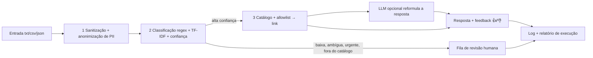

# 1. Propósito
Resume as decisões de base do **GS RPA 2S**: robô de triagem de pedidos de serviços públicos do cidadão
(FIAP GS 2026.2, AI for RPA). Cada linha aponta para o ADR que a justifica.

# 2. Stack e Ferramentas
| Decisão | Escolha | ADR |
|---|---|---|
| Stack | Python; interface Streamlit; scikit-learn (TF-IDF) e `re` | [[001-stack-principal]] |
| Persistência | CSV/JSON + SQLite local; sem cache | [[002-persistencia-sqlite-e-arquivos]] |
| Segurança | Sem login; sanitização, anonimização de PII, allowlist, revisão humana | [[003-seguranca-sem-autenticacao]] |
| Infraestrutura | Execução local/Colab; sem deploy e sem CI/CD | [[004-infra-execucao-local]] |
| LLM | Reformula a resposta final; só no modo opt-in escolhe entre fontes aprovadas; núcleo determinístico | [[005-llm-apenas-reformula-resposta]] · [[006-llm-escolhe-apenas-entre-fontes-aprovadas]] |

# 3. Diagramas / Estruturas

**Temas da disciplina e função no fluxo:** Automação/RPA (todo o pipeline: ingestão, agendamento, retry,
idempotência, relatório); NLP (etapa 2: limpeza e TF-IDF); Regras/regex (etapas 1 e 2: sanitização e atalhos);
Anonimização de PII (etapa 1). Governança é o eixo transversal.
