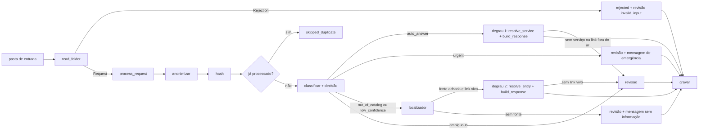

# 1. Propósito
Descreve `triage.pipeline` e o `run.py`: a composição de ingestão, anonimização, classificação, decisão, resposta em
degraus ou fila de revisão e persistência num robô de execução em lote, idempotente, que isola a falha de cada pedido e produz um
relatório de execução. O pacote só **compõe** os demais; não reimplementa etapa alguma.

# 2. Stack e Ferramentas
- Código em `src/triage/pipeline/` (`processor.py`, `runner.py`, `report.py`, `scheduler.py`) e `run.py` na raiz.
- Dependências por execução reunidas em `Deps` (repositório, `CatalogLookup`, `Settings`, modelo, cliente de LLM,
  política de retry e `ServiceFinder`, opcional: sem ele o degrau 2 fica de fora), montadas uma vez por `build_deps(settings, db_path)`; nada é carregado por pedido.
- **Comandos:** `python scripts/train_model.py` (gera o modelo) · `python run.py --input <pasta> --output <pasta>
  [--db <arquivo>] [--watch] [--interval <segundos>] [--llm | --no-llm]`.

# 3. Diagramas / Estruturas

**`process_request` — ordem fixa.** Anonimizar → `request_hash` → `already_processed` (então `skipped_duplicate`) →
classificar → `triage_decision` → o degrau, nesta ordem:
1. Modelo ausente: revisão `low_confidence`, mensagem genérica.
2. `auto_answer` (**degrau 1**, `tier=catalog`): `resolve_service` + `build_response`; se a resolução falhar, revisão
   com o motivo dela (`link_unavailable` ou `out_of_catalog`).
3. `urgent`: revisão com a **mensagem de emergência** e sem localizador.
4. `out_of_catalog` ou `low_confidence`: o `ServiceFinder` recebe o texto **anonimizado**. Fonte achada → `resolve_entry`
   verifica os links; vivo → resposta `answered` (**degrau 2**, `tier=finder`); sem link vivo → revisão
   `link_unavailable`. Sem fonte (ou sem localizador) → revisão com o motivo original e a mensagem **"não tenho a
   informação"** (**degrau 3**).
5. `ambiguous`: revisão com a mensagem genérica (duas categorias plausíveis exigem pessoa).

Depois, gravar com `save_request(..., anonymized=True)` e, se o pedido não foi respondido, `enqueue_review`. Só o texto
anonimizado é classificado, gravado ou logado. Devolve `ProcessingResult(status, category, confidence, reason,
response_text, link_status, used_llm, fallback_reason, tier)`, que nunca carrega o texto do cidadão; `tier` é `catalog`,
`finder` ou `None` (não respondido). O esquema do banco não muda: o pedido respondido pelo degrau 2 grava a categoria do
classificador (`other`).

**Caminhos seguros.**
- Modelo ausente: todo pedido vai à revisão com `low_confidence`, em vez de abortar a execução.
- Link fora do ar ou fora da allowlist: revisão com `link_unavailable`.
- LLM falhando: a resposta sai do template ([[03.02-resposta-final-e-llm]]).
- Falha inesperada em um pedido (inclusive `StorageError`): é capturada, logada **só com o tipo do erro**, contada em
  `error`, e o pedido tenta a fila de revisão (`low_confidence`, pois `ReviewReason` é conjunto fechado); a execução
  continua nos demais.
- A gravação (`save_request` e `enqueue_review`) repete até 3 vezes com `retry_with_backoff`, tratando `StorageError`
  como transitório.

**Rejeições da ingestão.** Cada `Rejection` vira registro `rejected` com revisão `invalid_input`; o hash vem de
`origem|motivo` e o texto gravado é um marcador com o motivo.

**`run_batch(input_dir, deps)`.** Abre `start_run()`, processa as rejeições e depois os pedidos, e **sempre** fecha com
`finish_run(totals)` e grava o relatório (`try/finally`), mesmo se a leitura da pasta falhar.

**Idempotência.** O hash do texto anonimizado é a chave: rodar de novo sobre a mesma entrada marca tudo como
`skipped_duplicate` e não cria registro, resposta nem item de fila novos.

**Relatório de execução** (`RunReport`): `run_id`, início, fim e duração; `totals` por status (`answered`,
`queued_for_review`, `rejected`, `skipped_duplicate`, `error`); contagem por categoria e por motivo de revisão (inclui
`invalid_input` das rejeições); `links` (`ok` e `unavailable`, contados por pedido); `tiers` (respondidos por degrau,
`catalog` e `finder`; no `.md`, "Respondidos por degrau"); uso de LLM e `fallbacks` por motivo.
Grava `<output>/reports/run-<data>-<id>.json` e `.md`. Não contém texto de pedido nem PII.

**Agendamento.** `watch(input_dir, interval_seconds, deps, stop_event)` chama `run_batch` a cada intervalo até o
evento ou Ctrl+C; erro numa rodada é logado e o laço segue. Alternativa externa: o cron ou o Agendador de Tarefas do
Windows chamando `python run.py --input <pasta>`, com a raiz do repositório como diretório de execução.

**Códigos de saída do `run.py`:** `0` execução concluída (mesmo com revisões); `1` falha de infraestrutura que impediu
a execução (banco ou disco inacessível); `2` argumento ou pasta de entrada inválidos. `--db` tem como padrão
`<output>/triage.db`; `--llm`/`--no-llm` sobrepõe `LLM_ENABLED`.

**Modelo.** É lido de `output/models/classifier.joblib` relativo à pasta atual ([[02.01-classificacao]]), não do
`--output`. Sem treino prévio, a execução termina com código 0 e todos os pedidos válidos vão à revisão.
